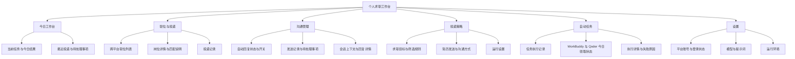
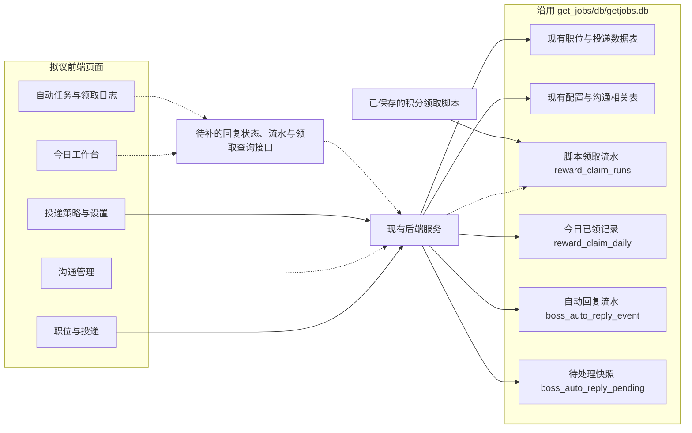
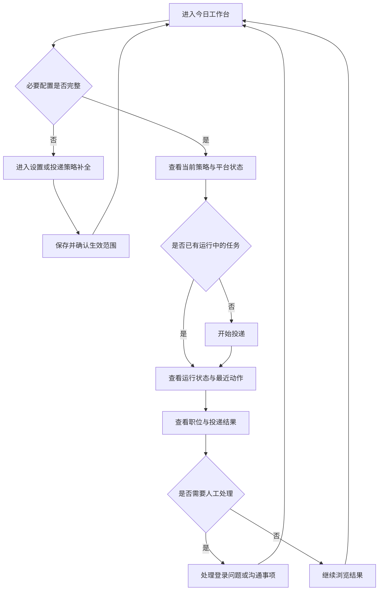

# Get Jobs 前端界面重设计方案

日期：2026-10-18
版本：v1.1（新增功能对齐）
状态：设计讨论稿，待页面原型评审
范围：产品定位、信息架构、页面布局、视觉方向和交互规则。本文不包含代码实现。

## 1. 设计目标

将现有配置管理页面整理成一个安静、清楚、适合每天使用的「个人求职工作台」。

用户进入系统后，应当容易回答四个问题：

1. 当前正在执行什么任务？
2. 求职进展如何，有哪些结果可以查看？
3. 现在有哪些事情需要我处理？
4. 自动回复是否在工作，为什么这轮没有回复？

整体弱化装饰，突出岗位、沟通、任务和结果之间的关系。AI 的价值通过具体判断与解释体现。

## 2. 现状与改进依据

本方案基于现有前端、控制器、自动回复与领取服务，以及数据库表结构核对整理，尚未进行浏览器内的逐页视觉验收。v1.1 补充未读自动回复、发送流水、每日领取记忆和低负载运行约束。

| 现状 | 带来的问题 | 改进方向 |
| --- | --- | --- |
| 首页默认进入环境配置 | 日常入口偏向安装维护，难以看到当前进展 | 首页改为今日工作台 |
| 侧栏按配置项和招聘平台组织 | 操作路径围绕系统设置展开 | 导航按用户任务组织，平台作为筛选维度 |
| 蓝紫渐变侧栏、柔光背景、半透明面板并用 | 装饰层次过多，模板感明显 | 使用中性色背景、实色表面与清晰文字层次 |
| 标题、按钮和模块都带有明显装饰 | 主要操作与辅助操作争夺注意力 | 每页明确一个主要操作，次要操作降低视觉权重 |
| 图标旋转、模块滑入、菜单移动及状态闪烁 | 高频使用时产生不必要的干扰 | 动效仅用于操作反馈和状态变化 |
| 平台配置内容较长，说明与表单反复分卡 | 浏览和修改成本较高 | 按用户决策顺序分组，折叠高级选项 |

视觉整改应先处理布局、层级和操作位置，再统一颜色与组件细节。

## 3. 产品信息架构

以下是拟议的前端页面结构，不代表相关页面或数据接口已经实现。



### 导航安排

- 顶层保持六个入口，名称直接描述用途。
- Boss 直聘、猎聘、51job、智联招聘放进平台筛选项或页面内标签。
- 新用户首次进入时提示完成必要配置；配置完成后，日常首页进入工作台。
- 平台专有设置保留在对应分组中，不强行合并含义不同的字段。
- 积分领取归入自动任务，首页只提示失败或需要处理的事项；今日已领取用安静的状态文字显示。
- 沟通管理进入第一批核心页面，自动回复开关不埋进 AI 配置或长投递表单。
- 自动回复当前仅支持 Boss，其他平台显示“未接入自动回复”。

## 4. 页面与数据关系架构

图中的虚线表示后续需要接入或核实的数据关系。前端通过后端读取数据；积分脚本沿用当前投简历数据库写入领取记录。



设计约束：

- 复用现有数据库，不为前端设计另建业务库。
- 页面按已有数据能力分阶段接入；无法确认的数据明确显示未接入或不可用。
- 领取脚本写入 `reward_claim_runs`；应用启动时的每日领取记忆写入 `reward_claim_daily`，两者不等同于同一张执行明细表。
- 回复流水、待处理和每日领取记录已落库，前端查询接口仍需补齐；浏览器不直接访问 SQLite。
- “自动任务”是任务管理入口的名称，不意味着所有任务已经配置定时执行。

## 5. 全局布局和视觉方向

### 5.1 桌面布局

以桌面使用为主，先设计约 1440 像素宽度的页面。

| 元素 | 拟议规格 | 用途 |
| --- | --- | --- |
| 左侧导航 | 约 216 像素 | 固定入口、当前页面、底部账户设置 |
| 页面顶栏 | 约 56 像素 | 页面标题、上下文和必要操作 |
| 内容边距 | 通常 24 像素 | 保持连续、统一的阅读起点 |
| 内容宽度 | 随窗口适配，表单设置合理上限 | 列表利用空间，表单避免横向拉得过长 |
| 分组间距 | 通常 24 像素 | 区分内容主题 |
| 圆角 | 通常 6–8 像素 | 保留温和感，减少胶囊与大圆角堆叠 |

这些数值是初稿基准，需在原型中结合中文内容长度调整。

### 5.2 配色与文字

| 角色 | 方向 |
| --- | --- |
| 页面背景 | 浅暖灰，例如 #F5F5F3 |
| 内容表面 | 白色 |
| 主文字 | 接近黑色的深灰，例如 #242424 |
| 次要文字 | 保持可读性的中灰，例如 #626262 |
| 主要操作 | 低饱和蓝，例如 #315F8C |
| 结果状态 | 绿色成功、橙色待处理、红色失败，并始终配文字 |
| 分隔线 | 浅灰，主要用于组织内容 |

- 中文优先使用系统字体，在 macOS 上采用苹方等系统无衬线字体。
- 页面标题约 22–24 像素，正文与表单约 14–16 像素，辅助说明约 12–13 像素。
- 标题、正文、说明形成三级层次，避免每张卡片都有大标题和图标底座。
- 数字与时间保持便于纵向比较的排版。
- 颜色最终需通过对比度检查，普通正文目标至少 4.5:1。
- 先完成浅色主题，深色主题沿用相同层级与状态语义。

### 5.3 装饰与动效

采用实色侧栏、细边框和克制的留白。阴影主要用于弹窗与浮层，常规内容区通过间距和分隔线组织。

菜单选中使用淡底色与加深文字；按钮悬停只进行轻微颜色变化。模块不逐个飞入，图标不旋转，正常连接状态不持续闪烁。

## 6. 核心页面一：今日工作台

### 页面任务

让用户看到当前执行情况、最近结果和需要人工处理的问题。

### 布局草图

以下为区域关系示意，框线用于说明分区，不代表每个区域都需要做成卡片。

```text
┌──────────────┬───────────────────────────────────────────────────┐
│ Get Jobs     │ 今日工作台                         日期 / 主要操作 │
│              ├───────────────────────────────────────────────────┤
│ 今日工作台   │ 当前任务                                          │
│ 职位与投递   │ 当前策略 · 平台 · 执行状态 · 最近动作     [停止任务] │
│ 沟通管理     ├───────────────────────────────────────────────────┤
│ 投递策略     │ 今日已投递       自动回复已发送       待处理              │
│ 自动任务     ├────────────────────────────────┬──────────────────┤
│              │ 最近投递                       │ 待处理事项       │
│              │ 岗位 / 公司 / 平台 / 结果      │ 登录失效         │
│              │ ……                            │ 需要人工回复     │
│              │                                ├──────────────────┤
│              │                                │ 平台连接状态     │
│ 设置         │                    查看全部 →  │ 最近检查时间     │
└──────────────┴────────────────────────────────┴──────────────────┘
```

### 内容与状态规则

- 当前任务占据首屏优先位置，正常运行时显示最近动作；空闲时显示已选策略与开始入口。
- 投递与自动回复分开显示状态；“停止投递”不表示自动回复已关闭。投递占用浏览器时，自动回复显示“等待投递结束”。
- 首屏增加自动回复摘要：开关、真实发送/仅预览、上次检查时间与结果、查看记录入口。后两项需要新接口。
- 主内容与辅助区大约七三开，最近投递为主，待处理事项为辅。
- 今日数字使用简洁的一排信息，不用三张大面积彩色卡片。
- 每项指标明确时间范围与统计口径，只显示后端实际能够提供的数据。
- “没有收到对方回复”“本轮没有未读”“尚未接入统计”“加载失败”必须区分。
- 今日自动回复数仅统计页面确认发送的事件，不计初次投递招呼语、预览、失败或跳过；待处理快照数不等于平台全部未读数。
- 待处理事项提供明确动作，例如重新登录、查看消息、查看失败原因。
- 首次使用时展示必要设置引导；已有配置的用户不再反复看到入门说明。

## 7. 核心页面二：职位与投递

### 页面任务

支持连续浏览、比较职位，并查看每个职位的筛选与投递依据。

### 布局草图

```text
┌──────────────┬───────────────────────────────────────────────────┐
│ 导航         │ 职位与投递                                        │
│              ├───────────────────────────────────────────────────┤
│              │ 搜索职位或公司    平台筛选    处理状态    更多筛选  │
│              ├──────────────────────────┬────────────────────────┤
│              │ 职位列表                 │ 选中职位详情           │
│              │                          │                        │
│              │ 岗位名称          薪资   │ 岗位名称 / 薪资        │
│              │ 公司 · 城市 · 经验       │ 公司与职位基本信息     │
│              │ 平台              状态   │                        │
│              │ ───────────────────────  │ 岗位要求               │
│              │ 下一条职位               │ 匹配说明与筛选依据     │
│              │ ……                       │ 投递与处理记录         │
│              │                          │                        │
│              │ 分页 / 已加载数量        │ 与当前状态匹配的操作   │
└──────────────┴──────────────────────────┴────────────────────────┘
```

### 设计规则

- 左侧约占六成，右侧约占四成；详情较长时允许独立滚动。
- 首层筛选只放高频条件：搜索、平台、处理状态；更多条件放入展开面板。
- 已选筛选条件以可移除的文字标签显示，并提供清空入口。
- 列表首先突出岗位与薪资，其次显示公司、城市、经验和处理状态。
- 状态使用文字与轻量标记，不依赖整行底色或单独的颜色点。
- 切换职位时保留筛选条件、列表滚动位置和选择上下文。
- 右侧按“岗位要求 → 匹配说明 → 投递记录 → 操作”的顺序组织。
- 匹配说明使用可解释的短句，例如薪资不符合条件；没有可靠依据时不展示主观匹配分。
- 当前数据如只能说明“已发起沟通”，就使用该措辞，不写成“简历已送达”或“对方已阅读”。
- 窄窗口下改成列表进入详情，并保留返回后的列表位置。

## 8. 核心页面三：投递策略

### 页面任务

让用户清楚知道系统按照什么条件寻找岗位、如何沟通、怎样执行。

### 布局草图

```text
┌──────────────┬───────────────────────────────────────────────────┐
│ 导航         │ 投递策略                                          │
│              │ 当前策略名称 · 适用平台 · 生效状态                 │
│              ├───────────────────────────────────────────────────┤
│              │ 策略摘要：目标岗位 / 城市 / 薪资范围                │
│              ├───────────────────────────────────────────────────┤
│              │ 求职目标                                          │
│              │ 岗位关键词       目标城市       薪资与经验          │
│              │ ───────────────────────────────────────────────── │
│              │ 筛选规则                                          │
│              │ 公司要求         排除条件       黑名单              │
│              │ ───────────────────────────────────────────────── │
│              │ 沟通方式                                          │
│              │ 招呼语 / 简历发送 / 重复沟通 / AI 辅助              │
│              │ ───────────────────────────────────────────────── │
│              │ 运行设置                          展开高级选项      │
│              ├───────────────────────────────────────────────────┤
│              │ 有未保存修改                    [取消修改] [保存]  │
└──────────────┴───────────────────────────────────────────────────┘
```

### 表单与生效规则

| 分组 | 内容 | 展示方式 |
| --- | --- | --- |
| 求职目标 | 关键词、城市、薪资、经验等 | 默认展开，高频内容优先 |
| 筛选规则 | 公司要求、排除规则、黑名单 | 分类展示，提供简短规则摘要 |
| 沟通方式 | 招呼语、现有简历发送能力、重复沟通、AI 辅助 | 明确启用条件和影响 |
| 运行设置 | 投递数量、间隔及平台支持的其他设置 | 常用选项展开，高级选项收起 |

- 说明紧邻对应字段，避免重复出现整张“平台说明”卡片。
- 字段使用可见标签，错误提示直接显示在字段附近。
- 修改后显示未保存状态；离开页面时提供保存、放弃修改或继续编辑的选择。
- 正在执行任务时，明确说明修改是下次启动生效还是即时生效，以实际能力为准。
- 尚未实现多策略存储时先展示当前配置，不预先承诺策略复制、版本回滚或多策略调度。
- 现有简历发送能力如仅在个别平台可用，其他平台需要明确标注可用性。

## 9. 沟通管理、自动任务与设置

### 9.1 沟通管理（第一批核心页面）

优先回答“自动回复正在做什么、已经发了什么、哪些需要处理”。首期依据已保存流水和待处理快照组织，不承诺全量同步 Boss 聊天记录或在工作台直接发送消息。

```text
沟通管理 · Boss
自动回复 [开启]   模式：真实发送   范围：仅未读
上次检查 21:00 · 未发现未读会话         [暂停自动回复] [设置]
说明：手动读过的旧消息不会作为新的自动回复对象。
─────────────────────────────────────────────────────
已发送 | 待处理 | 仅预览 | 全部记录       日期 / 会话搜索
时间     会话           处理结果             原因
21:00    某公司         已发送               页面确认发送
20:58    另一会话       暂缓处理             单会话每日上限
─────────────────────────────────────────────────────
选中记录详情：HR 原文 → 回复内容 → 结果、原因、处理时间
```

#### 必须区分的状态

| 状态 | 解释及操作 |
| --- | --- |
| 已关闭 | 自动回复未开启，提供开启入口 |
| 等待检查 | 已开启，等待下一轮；显示间隔，不伪造精确倒计时 |
| 本轮没有未读 | 上次检查未发现未读会话；不表示历史消息全部处理完成 |
| 等待投递结束 | 浏览器正在用于投递；与关闭或故障区分 |
| 消息读取失败 | 有会话但内容尚未确认，提供原因和手动处理说明 |
| 筛选/列表识别异常 | 未能确认未读筛选或列表状态，不包装成“没有未读” |
| AI 生成失败 | 尚未生成回复，保留待处理，不计作已发送 |
| 发送未确认 | 已尝试发送但没有确认成功，不计作已发送 |
| 仅预览 | 已生成内容但没有发送给 HR，独立计数 |
| 已发送 | 页面确认发送成功，展示实际回复原文 |

“上次检查”“识别异常”“因投递跳过”等尚无完整状态查询接口，实施时先补接口，不能根据 enabled 或健康检查推断。

#### 配置与数据口径

- 常用项：开启/暂停、真实发送/仅预览、间隔、每轮最多回复数、**单会话每日最多回复数**。现有 `maxPerDay` 不是全局每日额度。
- “仅未读”显示为当前范围说明；首期不增加补回全部已读消息的快捷开关。
- 程序已捕获的原未读消息若发送失败，会保留待处理；当前重试要求原消息仍可核实，不承诺切换会话后能自动找回全部目标。
- 详情至少显示 HR 原文、回复原文、时间、会话、结果、原因。待处理快照存在不表示消息在平台上仍未读。
- `SENT` 已发送；`PREVIEW` 仅预览；`AI_FAILED` 生成失败；`SEND_UNCONFIRMED` 发送未确认；`DEFERRED` 暂缓处理；`SKIPPED` 已跳过。
- 基础开关和额度已有配置接口；状态、流水与统计需要新查询接口。敏感词目前只能从配置接口读取，提示词未在该接口完整读写，不能先设计成可保存的表单。
- 一键重发、人工编辑后发送、全量聊天历史、标记人工处理完成，都需要相应接口与会话校验后再开放。

### 9.2 自动任务与积分领取

分开呈现“今天是否还会打开客户端”和“历史领取执行明细”。今日状态优先显示，历史按需展开。

| 今日摘要 | 展示内容与约束 |
| --- | --- |
| WorkBuddy / Qoder | 各自独立的状态、确认日期、确认时间 |
| 今日已确认领取 | 当天再次启动投递助手将跳过打开，不给出“再次领取”主按钮 |
| 今日暂无确认记录 | 尚未记录当天成功结果，不能直接断言“未到账”或“领取失败” |
| 领取策略 | 启动时检查，次日启动再检查；没有每日定时任务 |

今日摘要来自 `reward_claim_daily`，按北京时间自然日。该表没有积分数量、耗时、失败历史或确认来源，不推断金额、可用余额或“已通过接口自动核实”；用户确认的结果同样属于已确认记录。跳过启动不执行关闭命令，不影响用户已打开的客户端。

历史详情接入脚本的 `reward_claim_runs`：

| 字段 | 含义 |
| --- | --- |
| 客户端、执行来源 | WorkBuddy / Qoder，标明是脚本执行历史 |
| 时间与耗时 | 开始、结束、持续时间，以已保存字段为准 |
| 结果 | RUNNING 执行中、CLAIMED 本次领取成功、ALREADY 此前已领取、FAILED 失败、INTERRUPTED 待核实 |
| 本次新增 | `new_credits`，ALREADY 必须为 0 |
| 已核实奖励 | `confirmed_credits`，不等于本次新增 |
| 累计签到积分 | `total_credits`，不等于账户可用余额 |
| 有效期与失败原因 | 有值时展示，没有时标记未提供 |

- 应用启动领取不写入脚本执行明细，不能用今日确认记录拼出带虚构金额和耗时的历史。
- 脚本历史的 Qoder 周期从每日 10:00 起算；当前应用按北京时间自然日决定是否跳过启动。界面标注口径，接入时核对，不静默混算。
- 今日已领取和再次启动跳过均为正常结果，不使用失败色或反复提示。
- 两个客户端分别处理，未确认或失败不记为成功；WorkBuddy 未确认不阻止 Qoder 当日跳过启动。
- 两类数据都还没有前端查询接口。先实现只读查看，执行和重试入口等后端支持后再开放。

### 9.3 设置

平台账号、模型、提示词和环境设置集中放在这里。登录状态旁显示最近检查时间；退出登录放到账户操作菜单中。

普通用户看到可理解的状态与处理建议，技术诊断信息通过展开详情查看。

- 平台状态区分“未打开/按需启动”“已打开但未登录”“已登录”“检查失败”。未使用的猎聘、51job、智联不作为系统故障。
- 启动领取策略归入设置的启动行为，目前由配置文件控制，尚无保存接口，不放置看似有效的开关。
- 低负载运行先提供说明和按需诊断，不增加默认常驻的 CPU 曲线或高频性能监控。

## 10. 核心操作流程



开始与停止操作必须基于后端确认后的状态反馈。若状态确认失败，明确显示尚未确认；不以按钮点击成功代替任务已经启动或停止。

## 11. 统一交互与状态

| 情况 | 界面反馈 |
| --- | --- |
| 数据加载 | 保留页面结构，内容区显示加载占位，避免整个页面跳动 |
| 首次使用 | 显示必要设置引导和清晰的下一步 |
| 筛选后无结果 | 展示当前筛选条件，并提供清除筛选入口 |
| 暂无执行记录 | 解释何时会产生记录，避免制造空白图表 |
| 保存成功 | 就近状态更新或短暂轻提示，避免反复确认弹窗 |
| 字段错误 | 错误就近出现，保留已经输入的内容 |
| 网络失败 | 保留已有内容，标注更新时间与错误，提供适用的重试入口 |
| 登录过期 | 明确指出对应平台和重新登录入口 |
| 任务停止中 | 保留停止中的状态，待后端确认后再变为已停止 |

通用要求：

- 主操作使用实色按钮，普通操作使用描边或文字样式。
- 危险操作使用明确文字并适当确认，不让退出登录与开始投递具有相同视觉权重。
- 所有键盘可操作控件保留可见焦点；图标按钮具备可理解的名称。
- 详情和弹窗关闭后，焦点回到触发位置。
- 状态同时使用文字与颜色，照顾色觉差异。
- 表单错误保留上下文，不清空用户输入。
- 动效短促且可减少；固定操作栏不能遮住内容或键盘焦点。

## 12. 实施顺序建议

本文仅确定设计顺序，具体开发需另行确认。

1. **补齐可观察数据**：回复状态、上次检查、发送流水、统计、今日领取摘要；确定接口与口径。
2. **工作台与沟通管理原型**：优先解决“是否运行、为何没回复、到底发了什么”，同时确认导航和基础组件。
3. **投递策略与职位页面**：保留图片简历、重复沟通、筛选和黑名单，逐步迁移长表单。
4. **自动任务与设置**：先接今日只读摘要，再接有明确来源的领取明细；执行按钮按后端能力开放。
5. **真实状态验收与低负载检查**：覆盖空未读、发送成功、读取失败、生成失败、投递占用、当天重启、跨天、窄窗口和键盘操作。

## 13. 设计评审标准

- [ ] 首屏能够看清当前任务和下一步操作。
- [ ] 每个页面的主要操作有明确层级。
- [ ] 平台切换后，公共操作的位置与名称保持一致。
- [ ] 高频操作无需在长配置页中反复寻找。
- [ ] 选择职位后，能够连续阅读详情与处理记录。
- [ ] 配置修改的保存状态和生效范围清楚。
- [ ] 已领取、实际新增和可用余额的含义没有混用。
- [ ] 无未读与识别异常反馈不同，真实发送与仅预览清楚区分。
- [ ] 每日回复额度明确为单会话额度。
- [ ] 今日已领明确显示“本日重启不再打开”，不承诺定时领取。
- [ ] 未打开的平台不被当作故障，全局状态查看不会启动所有平台。
- [ ] 空数据、未接入、失败和执行中断具有不同呈现。
- [ ] 页面没有缺乏真实数据支撑的统计、图表或承诺。
- [ ] 阴影、图标、颜色与动效都服务于信息理解和操作反馈。

## 14. 下一步设计交付物

下一步优先制作今日工作台、沟通管理和投递策略的低保真原型，补充关键状态与接口缺口。职位页与领取详情随后完成。原型评审后再确认组件规格和实际开发范围。

当前文档中的页面架构、布局草图与流程图均为设计提案，不代表前端已经完成重构。


## 15. v1.1 功能落点与实现边界

| 能力 | 界面落点 | 已有依据 | 还需补齐 |
| --- | --- | --- | --- |
| 自动回复开关、模式、额度 | 沟通管理顶部与设置 | `/api/boss/auto-reply/config` GET/POST | 生效反馈、运行阶段和检查状态查询 |
| 原文、实际回复、结果、原因 | 沟通列表与详情 | `boss_auto_reply_event` | 分页、筛选、详情和统计接口 |
| 系统保留的待处理消息 | 沟通管理待处理页签 | `boss_auto_reply_pending` | 查询接口；不可等同于平台全部未读 |
| 图片简历、重复沟通 | 投递策略 → 沟通方式 | Boss 页现有能力 | 布局迁移，保留生效范围说明 |
| HR 活跃筛选、白名单、排除词 | 投递策略 → 筛选规则 | 现有配置与过滤逻辑 | 梳理前端未覆盖的配置读写 |
| 当天已领取不再打开 | 自动任务 → 今日领取 | `RewardClaimHistory` / `reward_claim_daily` | 今日摘要接口 |
| 领取金额、周期与历史 | 自动任务 → 历史详情 | 独立脚本 / `reward_claim_runs` | 查询接口与来源/周期标注 |
| 按需打开平台 | 设置 → 平台连接 | `/api/playwright/status` 与平台 open POST | 更准确的页面关闭状态查询 |
| 减少后台负载 | 全局交互要求 | 当前低负载启动及健康轮询优化 | 新页面不引入重复订阅或频繁请求 |

### 低负载交互约束

- 状态区优先复用共享订阅，切页清理监听与请求，避免重复连接。
- 隐藏标签页暂停非必要轮询；服务端自动回复不依赖管理页是否打开。
- 服务健康状态只说明可达，不能代替平台登录、回复模式、任务阶段和发送结果。
- 日志分页、详情按需读取，不整页加载全部历史或默认展开全部聊天正文。
- 正常状态不持续闪烁，动效只用于短暂反馈；实时性能曲线不作为首期内容。

### 依据与范围

依据为现有前端、控制器、自动回复服务、每日领取服务、数据库表结构和工作区领取历史说明。UI/UX 本地规则检索命中空状态解释与操作反馈；Next.js 轮询专项两次检索未命中，刷新约束依据现有代码及用户低负载目标制定。

本轮仅修订设计文档，没有修改前端页面或运行中的业务逻辑。
